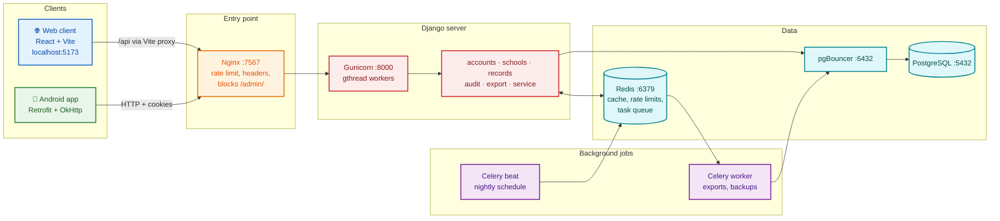
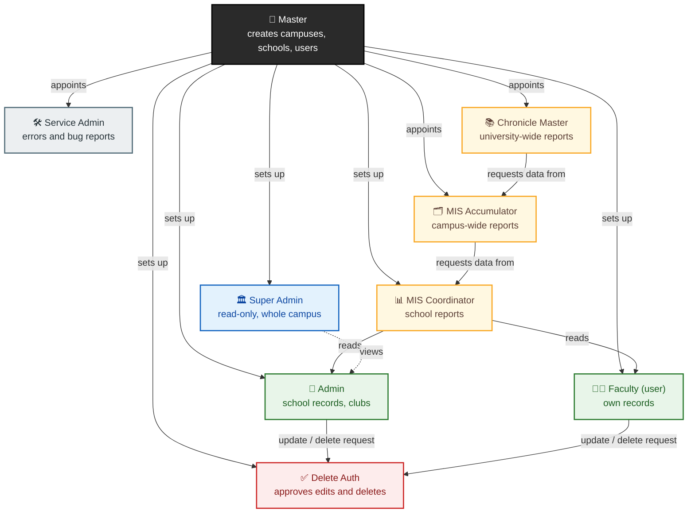
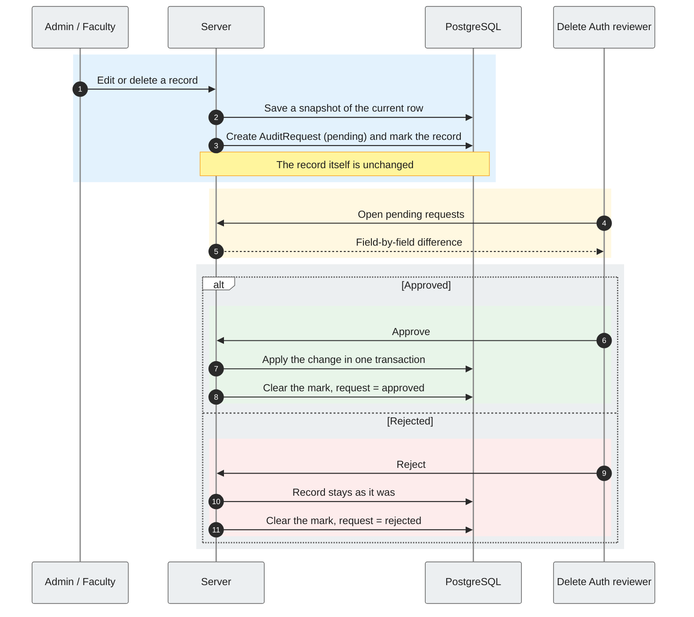
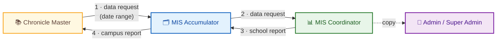
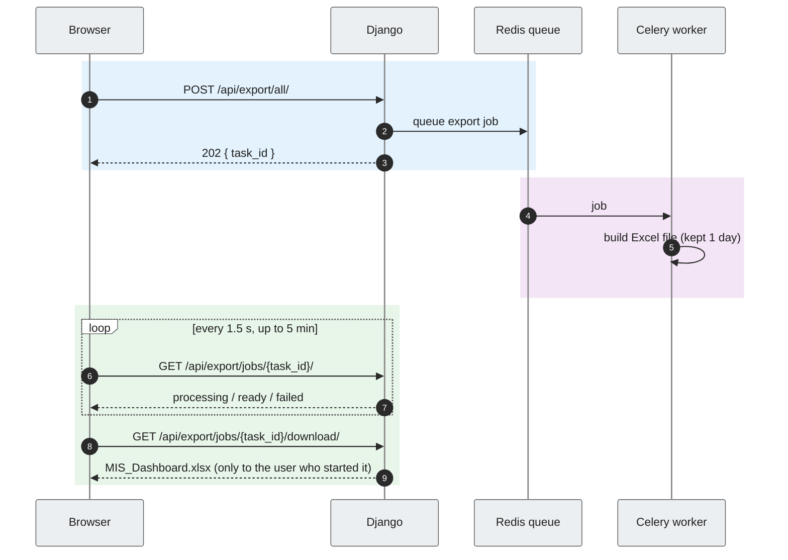
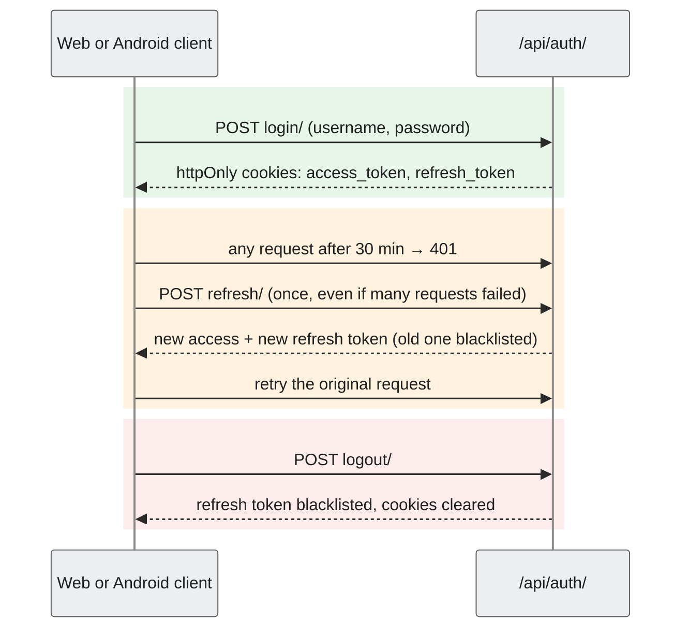
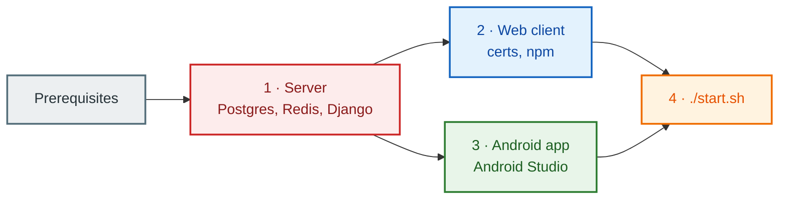
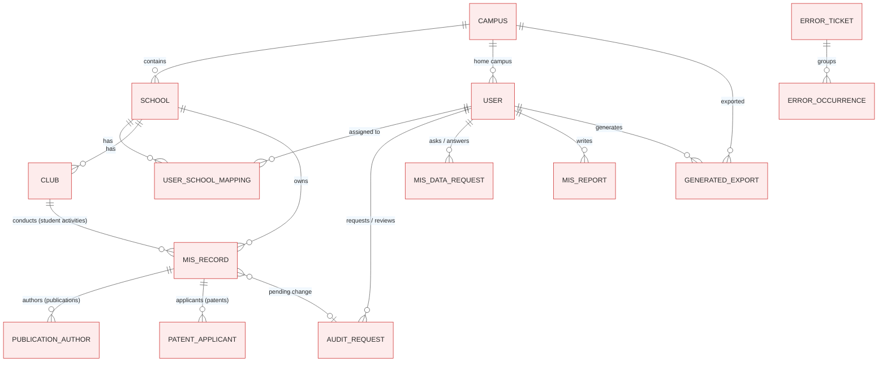
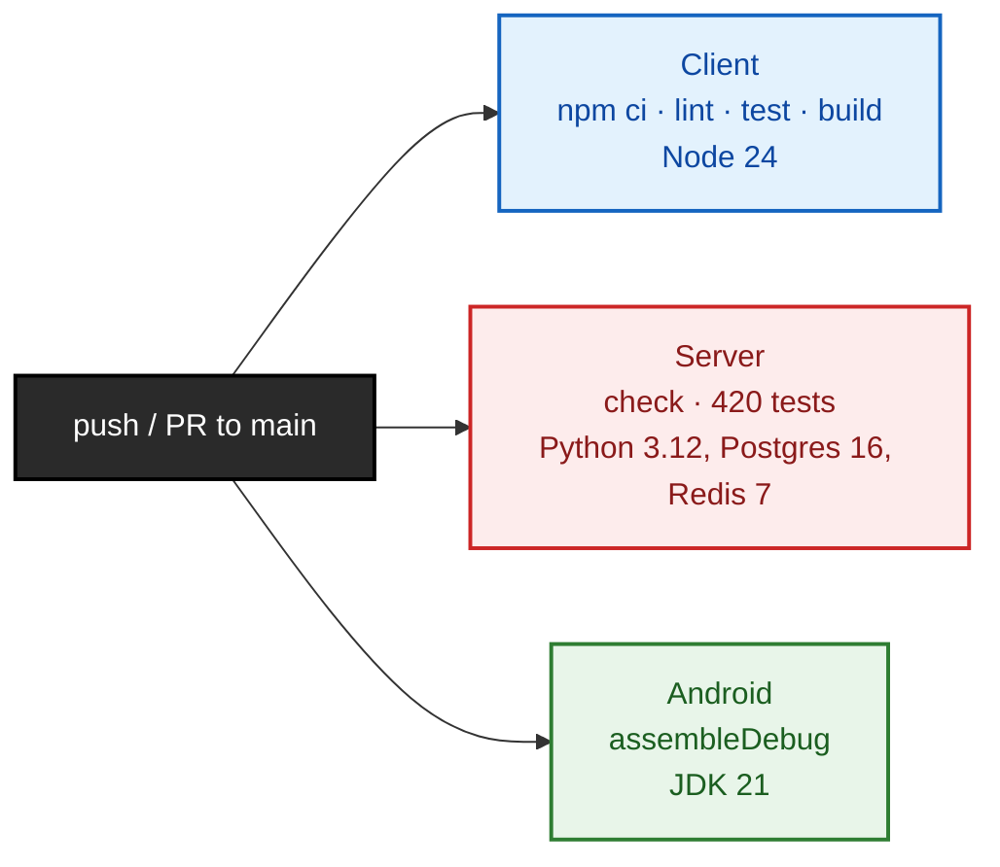

# NMPralekh — MIS Dashboard Portal

[](LICENSE)


NMPralekh is a Management Information System (MIS) portal for NMIMS University, built for all 9 campuses.
Schools record their faculty and student activities, publications, patents, certifications and placements in one place.
Every edit and delete goes through an approval step, and MIS reports flow upward from school to campus to university.

The project has three parts that share one API:

| Part | Folder | What it is | Built with |
|---|---|---|---|
| 🖥️ **Server** | [`server/`](server) | REST API, database, background jobs | Django 6, DRF, PostgreSQL, Redis, Celery |
| 🌐 **Web client** | [`client/`](client) | Full portal for every role | React 19, Vite 8, Tailwind CSS 3 |
| 📱 **Android app** | [`android-client/`](android-client) | Native app for faculty, admins, super admins and reviewers | Java, Material Components, Retrofit, OkHttp |

> **Status:** alpha. It runs on localhost today; the production hardening steps are listed in [Going to production](#going-to-production).

---

## Contents

- [Architecture](#architecture)
- [User roles](#user-roles)
- [MIS record modules](#mis-record-modules)
- [Key workflows](#key-workflows)
- [Repository layout](#repository-layout)
- [Setup guide](#setup-guide)
  - [1. Server](#1-server-setup)
  - [2. Web client](#2-web-client-setup)
  - [3. Android app](#3-android-app-setup)
  - [4. Running everything](#4-running-everything)
- [Infrastructure tuning](#infrastructure-tuning)
- [API reference](#api-reference)
- [Database schema](#database-schema)
- [Testing and CI](#testing-and-ci)
- [Security](#security)
- [Going to production](#going-to-production)
- [Project rules](#project-rules)
- [Developer and license](#developer-and-license)

---

## Architecture



| Django app | Responsibility |
|---|---|
| `accounts` | Users, the 9 roles, cookie-based JWT login, refresh and logout, login rate limits |
| `schools` | Campuses, schools, and which users belong to which school |
| `records` | The 7 MIS modules, clubs, co-authors and co-applicants, dashboard counts, database backups |
| `audit` | Approval queue for every update and delete |
| `export` | Excel exports (per module, "Export all", nightly, manual), MIS data requests and reports |
| `service` | Service portal: automatic error tickets, bug reports, system health |

---

## User roles



| Action | master | super_admin | admin | faculty | delete_auth | mis_coordinator | mis_accumulator | chronicle_master | service_admin |
|---|---|---|---|---|---|---|---|---|---|
| Create campuses, schools, users | ✅ | ❌ | ❌ | ❌ | ❌ | ❌ | ❌ | ❌ | ❌ |
| Assign users to schools | ✅ | ❌ | ❌ | ❌ | ❌ | ❌ | ❌ | ❌ | ❌ |
| View all campus records and users | ❌ | ✅ | ❌ | ❌ | ❌ | ❌ | ❌ | ❌ | ❌ |
| View school faculty, manage clubs | ❌ | ❌ | ✅ | ❌ | ❌ | ❌ | ❌ | ❌ | ❌ |
| View own school's records | ❌ | ✅ | ✅ | ✅ | ❌ | ✅ | ❌ | ❌ | ❌ |
| Create records | ❌ | ❌ | ✅ | ✅ | ❌ | ❌ | ❌ | ❌ | ❌ |
| Request update / delete | ❌ | ❌ | ✅ | ✅ | ❌ | ❌ | ❌ | ❌ | ❌ |
| Approve / reject changes | ❌ | ❌ | ❌ | ❌ | ✅ | ❌ | ❌ | ❌ | ❌ |
| Export Excel | ❌ | ✅ | ✅ | ✅ | ❌ | ✅ | ✅ | ✅ | ❌ |
| Write and send MIS reports | ❌ | ❌ | ❌ | ❌ | ❌ | ✅ | ✅ | ✅ | ❌ |
| AI summarizer | ❌ | ❌ | ❌ | ❌ | ❌ | ✅ | ✅ | ✅ | ❌ |
| Error tickets and bug reports | ❌ | ❌ | ❌ | ❌ | ❌ | ❌ | ❌ | ❌ | ✅ |

There is only one Service Admin and one Chronicle Master; the database enforces this.

---

## MIS record modules

| Module | Key fields |
|---|---|
| School Activities | Name, date, details, school-wide flag, collaborating schools |
| Student Activities | Name, date, details, club or committee (or free text), collaborations |
| Faculty FDP / Workshop / GL | Faculty, start and end date, name, type, organizing body |
| Faculty Publications | Authors (ordered), title, journal or conference, date, venue, DOI / link (required) |
| Patents | Applicants, title, publication date, journal number, status, DOI / link (required) |
| Certifications | Person, date, course title, agency, Credly / proof link (required) |
| Placement Activities | Name, date, details, PlaceCom, company |

**Clubs and committees** are managed by admins and belong to a school. Types: Club, Committee and Placement Committee. Student activities pick a club from a searchable list, with an "Other" option for free text.

---

## Key workflows

### Edit and delete approval

Records are never changed or deleted directly. The original stays as it is until a reviewer decides.



### MIS reporting chain



Each report records when it was sent to each recipient. A retried or double-clicked request cannot ask the same coordinator twice for the same dates.

### "Export all" in the background

Large exports run in Celery so they never block the web server.



### Login and session

Both clients use the same cookies: a 30-minute **access token** and a 6-hour **refresh token** that rotates on every use.



### Scheduled jobs

| Job | When | What it does |
|---|---|---|
| Nightly export | 12:00 AM IST daily | One Excel file per campus in `server/exports/` |
| Database backup | Set by the master in the portal | `pg_dump` to `server/backups/` |
| Manual export | On demand (master) | Campus export with a date range |

Every export file name ends in a random 8-character ID, so a manual export and a nightly export can never overwrite each other.

---

## Repository layout

```
nmpralekh/
├── server/                         Django backend
│   ├── apps/
│   │   ├── accounts/               users, roles, JWT cookies, rate limits
│   │   ├── schools/                campuses, schools, user ↔ school mapping
│   │   ├── records/                MIS modules, clubs, dashboard counts, backups (tasks.py)
│   │   ├── audit/                  approve / reject workflow
│   │   ├── export/                 Excel exports, Celery tasks, MIS reports
│   │   └── service/                error tickets, bug reports, health
│   │       (each app: models.py · serializers.py · views.py · urls.py · tests.py · migrations/)
│   ├── config/
│   │   ├── settings.example.py     copy to settings.py (gitignored)
│   │   ├── wsgi.example.py         copy to wsgi.py (gitignored)
│   │   ├── pgbouncer.example.ini   pgBouncer template
│   │   ├── redis.example.conf      Redis template
│   │   ├── celery.py               Celery app
│   │   ├── pagination.py           25 per page
│   │   └── urls.py
│   ├── backups/                    pg_dump files (gitignored)
│   ├── exports/                    generated Excel files (gitignored)
│   ├── gunicorn.conf.py
│   ├── locustfile.py               load test
│   ├── manage.py
│   ├── requirements.txt
│   └── .env.example                copy to .env
│
├── client/                         React web app
│   ├── public/                     favicon.ico, apple-touch-icon.png
│   ├── src/
│   │   ├── api/                    axios.js (cookies + auto refresh), errors.js (+ test)
│   │   ├── components/
│   │   │   ├── layout/             Layout, Sidebar
│   │   │   ├── ui/                 Table, Modal, Button, Badge, StatCard, SearchableSelect, …
│   │   │   ├── shared/             AISummarizerPage
│   │   │   └── …                   ProtectedRoute, ErrorBoundary, BugReportButton
│   │   ├── context/                AuthContext
│   │   ├── hooks/                  useRecords, useSchools, useExport, useErrorReporter
│   │   ├── pages/                  auth · master · superadmin · admin · faculty · deleteauth
│   │   │                           coordinator · accumulator · chronicle · service · records
│   │   ├── App.jsx                 routes and role redirects
│   │   └── main.jsx
│   ├── vite.config.js              HTTPS + /api proxy
│   ├── tailwind.config.js          NMIMS palette
│   └── .env.example                copy to .env
│
├── android-client/                 Android app
│   ├── app/src/main/
│   │   ├── java/com/aarushchaudhary/nmpralekh/
│   │   │   ├── LoginActivity, FacultyActivity, AdminActivity,
│   │   │   │   SuperAdminActivity, DeleteAuthActivity, BaseAuthActivity
│   │   │   ├── ApiClient.java      OkHttp: saved cookies, CSRF, token refresh
│   │   │   ├── api/                ApiService (Retrofit endpoints)
│   │   │   ├── auth/               SessionManager
│   │   │   ├── adapters/           RecordAdapter, AuditAdapter
│   │   │   └── fragments/          one per module, dashboards, audit screens
│   │   ├── res/                    layout · menu · drawable · color · values (NMIMS theme)
│   │   │                           mipmap-* (launcher icons, adaptive on Android 8+)
│   │   └── AndroidManifest.xml
│   ├── app/build.gradle
│   └── gradle/libs.versions.toml   dependency versions
│
├── graphify-out/                   code knowledge graph
│   ├── graph.json                  the graph (used by graphify query)
│   ├── graph.html                  browsable view, built locally (gitignored)
│   ├── GRAPH_REPORT.md             architecture summary
│   └── .graphify_labels.json(.sig) cluster names
│
├── .github/workflows/release.yml   CI for all three parts
├── start.sh                        start every service with one command
├── locust.sh                       start the load test UI
├── .gitattributes                  merge rule for graph.json
├── LICENSE                         GNU GPL v3
└── README.md
```

Gitignored but created during setup: `server/venv/`, `server/.env`, `server/config/settings.py`, `server/config/wsgi.py`, `client/.env`, `client/node_modules/`, `localhost+1*.pem` (mkcert), `android-client/local.properties`.

---

## Setup guide



### Prerequisites

| Tool | Version | Needed for |
|---|---|---|
| Python | 3.12+ | Server |
| PostgreSQL | 15+ | Server |
| Redis | 6+ | Server (cache, rate limits, task queue) |
| pgBouncer | any recent | Server (recommended connection pooling) |
| Nginx | any recent | Server entry point; the web client's dev proxy points at it |
| Node.js | 22+ (CI uses 24) | Web client |
| mkcert | any | Web client (local HTTPS) |
| Android Studio + JDK 21 | latest | Android app |

Commands below are for Ubuntu / Debian. Clone the project first:

```bash
git clone <your-repo-url> nmpralekh
cd nmpralekh
```

### 1. Server setup

**1.1 Create the database**

```bash
sudo -u postgres psql
```

```sql
CREATE DATABASE nmpralekh ENCODING 'UTF8' TEMPLATE template0;
CREATE USER mis_user WITH PASSWORD 'your_strong_password';
ALTER ROLE mis_user SET client_encoding TO 'utf8';
ALTER ROLE mis_user SET default_transaction_isolation TO 'read committed';
ALTER ROLE mis_user SET timezone TO 'Asia/Kolkata';
ALTER ROLE mis_user CREATEDB;            -- lets the test runner create its test database
GRANT ALL PRIVILEGES ON DATABASE nmpralekh TO mis_user;
\c nmpralekh
GRANT ALL ON SCHEMA public TO mis_user;  -- required on PostgreSQL 15+
\q
```

**1.2 Install and start Redis**

```bash
sudo apt install redis-server -y
sudo systemctl enable --now redis-server
```

Set the memory policy to `volatile-lru` (see [Redis](#redis)). It keeps the Celery queue safe from eviction.

**1.3 Python environment and packages**

```bash
cd server
python3 -m venv venv
source venv/bin/activate
pip install -r requirements.txt
```

**1.4 Settings and environment**

```bash
cp config/settings.example.py config/settings.py
cp config/wsgi.example.py config/wsgi.py
cp .env.example .env
```

Edit `server/.env`:

| Key | Example | Notes |
|---|---|---|
| `SECRET_KEY` | long random string | generate below |
| `DEBUG` | `True` | `False` in production |
| `TIME_ZONE` | `Asia/Kolkata` | |
| `DB_NAME`, `DB_USER`, `DB_PASSWORD`, `DB_HOST` | `nmpralekh`, `mis_user`, … | |
| `DB_PORT` | `6432` | `6432` through pgBouncer, `5432` straight to PostgreSQL |
| `REDIS_URL` | `redis://127.0.0.1:6379` | |
| `CORS_ALLOWED_ORIGINS` | `https://localhost:5173` | comma-separated |
| `CSRF_TRUSTED_ORIGINS` | `https://localhost:5173` | must match the line above |
| `ALLOWED_HOSTS` | `localhost,127.0.0.1` | |

```bash
python -c "from django.core.management.utils import get_random_secret_key; print(get_random_secret_key())"
```

> Keep `settings.py` identical to `settings.example.py` except for local secrets, and keep `.env` and `.env.example` with the same keys.

**1.5 Migrate and create the master account**

```bash
python manage.py migrate
python manage.py createsuperuser   # this account gets the master role
```

**1.6 pgBouncer (recommended)**

Follow [pgBouncer](#pgbouncer) below, or skip it and set `DB_PORT=5432`.

**1.7 Nginx**

The web client sends `/api` to Nginx on port 7567, and Nginx passes it to Gunicorn on `127.0.0.1:8000`. Set it up as in [Nginx](#nginx).
To skip Nginx during development, change the proxy `target` in `client/vite.config.js` to `http://localhost:8000`.

**1.8 Check it works**

```bash
python manage.py check
python manage.py runserver        # dev server with auto-reload, http://127.0.0.1:8000
```

With `DEBUG=True`, interactive API docs are at **http://127.0.0.1:8000/api/docs/**.

### 2. Web client setup

**2.1 Local HTTPS certificates** (in the project root)

```bash
sudo apt install mkcert libnss3-tools -y
mkcert -install
mkcert localhost 127.0.0.1        # creates localhost+1.pem and localhost+1-key.pem
```

Vite uses these files when they exist and falls back to plain HTTP otherwise.

**2.2 Install and configure**

```bash
cd client
npm install
cp .env.example .env              # VITE_API_BASE_URL=/api for local development
```

**2.3 Run**

```bash
npm run dev                       # https://localhost:5173
```

| Script | What it does |
|---|---|
| `npm run dev` | dev server with hot reload |
| `npm run build` | production build into `client/dist/` |
| `npm run preview` | serve the production build locally |
| `npm run lint` | ESLint |
| `npm test` | unit tests (`node --test`) |

### 3. Android app setup

| Item | Value |
|---|---|
| Package | `com.aarushchaudhary.nmpralekh` |
| Min / target SDK | 24 (Android 7.0) / 36 |
| Build | Gradle with Android Gradle Plugin 9.3, JDK 21 |
| Default server | `http://10.0.2.2:8000` (the host computer, seen from the emulator) |

**3.1 Open and build**

1. Open `android-client/` in Android Studio and let Gradle sync.
2. Start the server (step 1 or `./start.sh`).
3. Press **Run** to install on an emulator or phone.

Or from the command line:

```bash
cd android-client
./gradlew assembleDebug
# APK: android-client/app/build/outputs/apk/debug/app-debug.apk
adb install -r app/build/outputs/apk/debug/app-debug.apk
```

**3.2 Point the app at your server**

Tap the ⚙️ settings button on the login screen and enter the server address:

| Where the app runs | Server URL |
|---|---|
| Android emulator | `http://10.0.2.2:8000` (default) |
| Phone on the same Wi-Fi | `http://<your-computer-LAN-IP>:7567` (through Nginx; Gunicorn only listens on localhost) |

**3.3 What the app does**

| Role | Screens |
|---|---|
| Faculty | Dashboard; add, edit and delete own records in all 7 modules |
| Admin | School records, clubs, faculty list, received MIS data |
| Super Admin | Read-only records across the campus, campus users |
| Delete Auth | Pending requests with field differences, approve / reject, history |

Other roles use the web portal.

Session behaviour:
- After the 30-minute access token expires, the app refreshes it and retries the request, without the user noticing.
- The login survives closing the app: cookies are saved in the app's private `no_backup` folder, which is never copied to cloud backups. Signing out deletes them.
- Network logging is on only in debug builds, and logs the request line and status only (never bodies, so never passwords or tokens).

### 4. Running everything

**One command** (asks for `sudo` to start Redis and pgBouncer):

```bash
./start.sh
```

It starts Redis, pgBouncer, Gunicorn, the Celery worker, Celery beat and the Vite dev server. **Ctrl+C** stops them all.

**Or in separate terminals:**

| Terminal | Command (from the project root) |
|---|---|
| Services | `sudo systemctl start redis pgbouncer nginx` |
| Backend | `cd server && source venv/bin/activate && gunicorn -c gunicorn.conf.py config.wsgi:application` |
| Celery worker | `cd server && source venv/bin/activate && celery -A config worker --loglevel=info --concurrency=4` |
| Celery beat | `cd server && source venv/bin/activate && celery -A config beat --loglevel=info --scheduler django_celery_beat.schedulers:DatabaseScheduler` |
| Web client | `cd client && npm run dev` |

> The Celery worker must be running for "Export all", nightly exports and backups. Without it, "Export all" waits 5 minutes and then shows an error.

Open **https://localhost:5173**.

**First use**

```mermaid
flowchart LR
    a["Log in as master"] --> b["Create a campus"] --> c["Create schools"] --> d["Create users"] --> e["Assign users<br/>to schools"]
    e --> f["Admin adds clubs"] --> g["Admin / faculty<br/>add records"] --> h["Edits and deletes<br/>go to Delete Auth"]

    classDef m fill:#2A2A2A,stroke:#000,color:#fff,stroke-width:2px
    classDef s fill:#E3F2FD,stroke:#1565C0,color:#0D47A1,stroke-width:2px
    classDef r fill:#E8F5E9,stroke:#2E7D32,color:#1B5E20,stroke-width:2px
    classDef v fill:#FDECEC,stroke:#CC2626,color:#8A1A1A,stroke-width:2px
    class a m
    class b,c,d,e s
    class f,g r
    class h v
```



---

## Infrastructure tuning

### pgBouncer

pgBouncer shares a small pool of database connections between all Gunicorn and Celery threads.

```bash
sudo apt install pgbouncer -y
sudo cp server/config/pgbouncer.example.ini /etc/pgbouncer/pgbouncer.ini   # then fill in your values
```

The important settings: `listen_port = 6432`, `pool_mode = transaction`, `default_pool_size = 20`, `auth_type = scram-sha-256`.

Create `/etc/pgbouncer/userlist.txt` from PostgreSQL's own password hashes:

```sql
-- sudo -u postgres psql
SET password_encryption = 'scram-sha-256';
ALTER USER mis_user WITH PASSWORD 'your_strong_password';
SELECT rolname, rolpassword FROM pg_authid WHERE rolname = 'mis_user';
```

```text
"mis_user" "SCRAM-SHA-256$4096:..."
```

```bash
sudo systemctl enable --now pgbouncer
psql -U mis_user -d nmpralekh -h 127.0.0.1 -p 6432     # test, then \q
```

Then set `DB_PORT=6432` in `server/.env`. The settings already include what transaction pooling needs: `CONN_MAX_AGE = 0`, and `DISABLE_SERVER_SIDE_CURSORS = True` so large exports work through pgBouncer.

### Redis

Redis holds the cache, the rate-limit counters and the Celery queue. Template: `server/config/redis.example.conf`. In `/etc/redis/redis.conf`:

```conf
maxmemory 512mb
maxmemory-policy volatile-lru   # evict only keys with an expiry; never the Celery queue
maxclients 20000
```

Raise the file limit so Redis can accept that many clients:

```bash
sudo systemctl edit redis        # add:  [Service]  LimitNOFILE=65536
sudo systemctl daemon-reload && sudo systemctl restart redis
```

Or apply the memory settings live: `redis-cli CONFIG SET maxmemory 512mb` and `redis-cli CONFIG SET maxmemory-policy volatile-lru`.

If Redis goes down, the site keeps working: rate limits "fail open", and login falls back to an in-process limit of 1 attempt per second per user. The Service Admin dashboard shows Redis health.

### Gunicorn

Config: `server/gunicorn.conf.py`. The code is fully synchronous Django, so WSGI with threads fits better than ASGI.

```
workers = CPU cores × 2 + 1     → 9 on a 4-core machine
threads = 2                     → 9 × 2 = 18 DB connections, inside pgBouncer's pool of 20
```

| Setting | Value | Why |
|---|---|---|
| `bind` | `127.0.0.1:8000` | only Nginx can reach it |
| `worker_class` | `gthread` | good for I/O-bound Django |
| `timeout` | `120` | covers slow exports |
| `max_requests` / jitter | `1000` / `100` | recycles workers to cap memory growth |
| `preload_app` | `True` | faster start, less memory |

### Nginx

Nginx is the only public entry point: rate limiting (30 req/s per IP, burst 50), security headers, static files, and `/admin/` limited to localhost.

```nginx
# /etc/nginx/sites-available/nmpralekh-backend
limit_req_zone $binary_remote_addr zone=api:10m rate=30r/s;

server {
    listen 7567;
    server_name localhost;                       # your domain in production

    add_header X-Frame-Options        "DENY"                            always;
    add_header X-Content-Type-Options "nosniff"                         always;
    add_header Referrer-Policy        "strict-origin-when-cross-origin" always;

    location /static/ {
        alias /path/to/nmpralekh/server/staticfiles/;   # after collectstatic
        expires 30d;
    }

    location /admin/ {
        allow 127.0.0.1;
        deny all;
        proxy_pass       http://127.0.0.1:8000;
        proxy_set_header Host              $host;
        proxy_set_header X-Real-IP         $remote_addr;
        proxy_set_header X-Forwarded-For   $proxy_add_x_forwarded_for;
        proxy_set_header X-Forwarded-Proto $scheme;
    }

    location / {
        limit_req zone=api burst=50 nodelay;
        proxy_pass            http://127.0.0.1:8000;
        proxy_set_header      Host              $host;
        proxy_set_header      X-Real-IP         $remote_addr;
        proxy_set_header      X-Forwarded-For   $proxy_add_x_forwarded_for;
        proxy_set_header      X-Forwarded-Proto $scheme;
        proxy_read_timeout    120s;
        proxy_connect_timeout 10s;
        client_max_body_size  20M;
    }
}
```

```bash
sudo ln -s /etc/nginx/sites-available/nmpralekh-backend /etc/nginx/sites-enabled/
sudo rm -f /etc/nginx/sites-enabled/default
sudo nginx -t && sudo systemctl reload nginx
cd server && source venv/bin/activate && python manage.py collectstatic
```

Firewall (optional on a dev machine):

```bash
sudo ufw allow ssh && sudo ufw allow 7567/tcp && sudo ufw deny 8000/tcp && sudo ufw enable
```

Check: `curl -sI http://localhost:7567/api/auth/me/ | grep -i server` shows `nginx`.

---

## API reference

All endpoints are under `/api/`. With `DEBUG=True` the full interactive schema is at `/api/docs/` (Swagger) and `/api/schema/` (OpenAPI).

<details>
<summary><b>Auth and users</b></summary>

```
POST   /api/auth/login/                       sets httpOnly cookies (10 / min per IP)
POST   /api/auth/refresh/                     rotates tokens (30 / min per IP)
POST   /api/auth/logout/                      blacklists the refresh token, clears cookies
GET    /api/auth/me/

GET    POST            /api/users/            master
GET    PUT PATCH DELETE /api/users/<id>/      master (delete = deactivate)
GET    POST PATCH      /api/users/master/service-user/
GET    POST PATCH      /api/users/master/chronicle-master/
GET    /api/users/school-faculties/           admin
GET    /api/users/campus-users/               super admin
GET    /api/users/accumulator-coordinators/   MIS accumulator
GET    /api/users/chronicle/accumulators/     chronicle master
```
</details>

<details>
<summary><b>Campuses and schools</b></summary>

```
GET    POST             /api/schools/campuses/
GET    PUT PATCH DELETE /api/schools/campuses/<id>/
POST   /api/schools/campuses/<id>/reactivate/
GET    /api/schools/campuses/<id>/schools/
GET    /api/schools/campuses/<id>/users/
GET    POST             /api/schools/
GET    PUT PATCH DELETE /api/schools/<id>/
POST   /api/schools/<id>/reactivate/
GET    POST             /api/schools/assign/
GET    DELETE           /api/schools/assign/<id>/
GET    /api/schools/my-schools/
GET    /api/schools/faculty/
```
</details>

<details>
<summary><b>Records, clubs, backups</b></summary>

```
GET    POST             /api/records/<module>/
GET    PUT PATCH DELETE /api/records/<module>/<id>/      update / delete → 202, goes to audit
       <module> = school-activities | student-activities | fdp | publications
                  | patents | certifications | placements | clubs
GET    POST             /api/records/publications/<id>/authors/
GET    PUT PATCH DELETE /api/records/publications/<id>/authors/<id>/
GET    POST             /api/records/patents/<id>/applicants/
GET    PUT PATCH DELETE /api/records/patents/<id>/applicants/<id>/
GET    /api/records/dashboard-counts/                    cached 60 s
GET    /api/records/faculty-users/
GET    PUT  /api/records/backup-config/                  master
POST   /api/records/backup-manual/                       master
```
</details>

<details>
<summary><b>Audit</b></summary>

```
GET    /api/audit/                    pending requests
GET    /api/audit/<id>/
POST   /api/audit/<id>/approve/
POST   /api/audit/<id>/reject/
GET    /api/audit/history/
```
</details>

<details>
<summary><b>Exports and MIS reports</b></summary>

```
GET    /api/export/<module>/                     one module as .xlsx (10 / min, max 5000 rows)
POST   /api/export/all/                          start "Export all" → 202 {task_id} (5 / min)
GET    /api/export/jobs/<task_id>/               processing | ready | failed
GET    /api/export/jobs/<task_id>/download/      the file, only for the user who started it
GET    /api/export/coordinator/                  MIS coordinator export
GET    /api/export/accumulator/dashboard/   GET /api/export/accumulator/export/
POST   /api/export/accumulator/request-all/
GET    /api/export/chronicle/dashboard/     GET /api/export/chronicle/export/
GET    POST /api/export/chronicle/data-requests/

GET    /api/export/history/                      master: generated files
GET    /api/export/download/<id>/
POST   /api/export/manual/                       master: campus export (Celery)
POST   /api/export/nightly/trigger/
GET    /api/export/status/<task_id>/

GET    POST          /api/export/data-requests/
GET    PUT PATCH     /api/export/data-requests/<id>/
GET    POST          /api/export/reports/
GET    /api/export/reports/received/
POST   /api/export/reports/<id>/send-admin/ | send-accumulator/ | send-superadmin/ | send-chronicle/
```
</details>

<details>
<summary><b>Service portal</b></summary>

```
GET    /api/service/stats/
GET    /api/service/api-status/             PostgreSQL, Redis, Celery health
GET    /api/service/tickets/
GET    /api/service/tickets/<id>/
POST   /api/service/tickets/<id>/status/
GET    /api/service/bug-reports/
POST   /api/service/bug-reports/submit/
GET    PUT PATCH /api/service/bug-reports/<id>/
POST   /api/service/report-error/           automatic error reports from the clients
```
</details>

Common query parameters: `page`, `page_size` (default 25), `search`, `school_id`, `campus_id`, `date_from`, `date_to`, `status`, `type`, `is_active`, `role`, `school_code`.

---

## Database schema



`MIS_RECORD` stands for the 7 module tables. They all share `school_id` (data isolation), `created_by`, `created_at`, `updated_at` and `pending_audit` (link to an open change request).

Rules the database enforces itself:
- End dates are never before start dates (FDP, data requests, reports).
- Only one Service Admin and one Chronicle Master.
- Only one pending data request per accumulator, coordinator and date range.
- PostgreSQL runs with `fsync`, `synchronous_commit` and `full_page_writes` on; multi-step writes run inside transactions, and counters use row locks.

---

## Testing and CI

### Server: 420 tests

```bash
cd server && source venv/bin/activate
python manage.py test                     # all apps
python manage.py test apps.export         # one app
```

Tests run on real PostgreSQL (port 5432 directly, never through pgBouncer) and on Redis database **15**, so they never touch the app's cache or Celery queue. `mis_user` needs `CREATEDB`.

| App | Covers |
|---|---|
| accounts | user model, all permission classes, login / refresh / logout, rate limits during a Redis outage, single Service Admin and Chronicle Master |
| schools | campus and school CRUD, scoping per role, mapping rules |
| records | all modules, audit-gated updates (202), soft delete, date rules, dashboard counts |
| audit | approve and reject, history, permissions |
| export | exports, background "Export all" (owner-only download), MIS requests and reports, integrity rules |
| service | error fingerprinting and de-duplication, affected-user counts, tickets, bug reports |

### Web client

```bash
cd client
npm run lint && npm test && npm run build
```

### Android

```bash
cd android-client && ./gradlew assembleDebug
```

### Continuous integration

`.github/workflows/release.yml` runs on every push and pull request to `main`:



### Load testing (Locust)

`server/locustfile.py` simulates all 9 roles, weighted like real traffic (faculty about 60%). Each virtual user reads a JWT from an environment variable such as `LOCUST_TOKEN_FACULTY` (copy the `access_token` cookie from the browser's DevTools).

```bash
./locust.sh                                                    # UI at http://localhost:8089
cd server && locust -f locustfile.py --host=http://127.0.0.1:8000 --headless --users 500 --spawn-rate 10 --run-time 5m
locust -f locustfile.py --tags records --host=http://127.0.0.1:8000           # one area only
```

Tags: `structure`, `users`, `dashboard`, `records`, `audit`, `export`, `reports`, `service`, `schools`, `config`, `auth`.
Healthy targets: median under 150 ms, 95th percentile under 500 ms, failures under 1%.

### Code knowledge graph

`graphify-out/` holds a code map built with [graphify](https://github.com/Graphify-Labs/graphify). After cloning, run `graphify update .` once (code only, no API cost) and `graphify hook install` to rebuild it after every commit. Then `graphify query "how does export work"` answers code questions without reading every file.

---

## Security

| Area | How |
|---|---|
| Login tokens | JWT in `httpOnly` cookies, so page scripts cannot read them |
| Session length | 30-minute access token, 6-hour refresh token, rotated on every use, old one blacklisted |
| Logout | refresh token blacklisted in the database, cookies cleared (works even with an expired token) |
| Brute force | login 10 / min per IP; 1 / s per user fallback if Redis is down; Nginx 30 req/s |
| API throttles | 60 / min anonymous, 300 / min signed in; exports 5–10 / min per user |
| Data isolation | every query scoped to the user's schools and campus |
| Changes | updates and deletes need reviewer approval; records are soft-deleted |
| Passwords | Django PBKDF2-SHA256 |
| CORS / CSRF | only the configured origins |
| SQL injection | Django ORM parameterised queries only |
| Admin panel | `/admin/` reachable from localhost only (Nginx) |
| HTTPS | HSTS (1 year) and HTTPS redirect when `DEBUG=False` |
| Android | debug-only, body-free network logs; saved login kept out of cloud backups |

---

## Going to production

The app currently runs in alpha on localhost. Before a real deployment:

- [ ] `DEBUG=False` and a new `SECRET_KEY` in `server/.env`
- [ ] Restrict `ALLOWED_HOSTS` in `settings.py` (it is `['*']` for local alpha use) and set `CORS_ALLOWED_ORIGINS` and `CSRF_TRUSTED_ORIGINS` to the real domain
- [ ] Nginx on 80 / 443 with `certbot`, `server_name` set to the domain, static path updated
- [ ] Production build of the client (`npm run build`), with `VITE_API_BASE_URL` set if the API is on another domain
- [ ] Android: a release build signed with your key, `usesCleartextTraffic` turned off, HTTPS server URL
- [ ] Redis `volatile-lru`, pgBouncer, a Celery worker and beat running as services
- [ ] Backups configured by the master, and tested with a restore

---

## Project rules

- Never commit `.env`, `settings.py` or `wsgi.py`. Copy them from the `.example` files.
- Always commit `migrations/`.
- All edits and deletes of records go through audit.
- Faculty see and manage only their own publications, patents and certifications.
- Super Admins are read-only.
- Only the master creates campuses, schools and users.
- DOI / link is required for publications, patents and certifications.
- Dropdowns use the searchable `SearchableSelect` component.

---

## Developer and license

Designed and developed by **Aarush Chaudhary**.

Copyright © 2026 Aarush Chaudhary

This program is free software: you can redistribute it and/or modify it under the terms of the
**GNU General Public License** as published by the Free Software Foundation, either **version 3** of the
License, or (at your option) any later version.

This program is distributed in the hope that it will be useful, but **without any warranty**; without even
the implied warranty of merchantability or fitness for a particular purpose. See the
[GNU General Public License](LICENSE) for more details.

You should have received a copy of the GNU General Public License along with this program.
If not, see <https://www.gnu.org/licenses/>.

SPDX-License-Identifier: `GPL-3.0-or-later`
